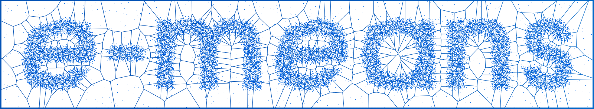
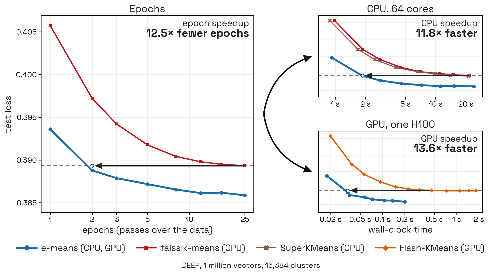

<p align="center">
  
</p>

# e-means: outperforming k-means in one-tenth the epochs

arXiv (soon) · Blog post link (soon) · Reproduction scripts (link) · Browser demo link (soon)


## What e-means is

A modern, robust replacement for k-means developed at Meta FAIR. e-means delivers a **~10× speedup in epochs and wall-clock** while achieving **lower loss** compared to Lloyd's k-means, with no additional hyperparameters. e-means uses a mini-batch update rule specialized for the k-means problem, based on exponential moving averages.

## When to use it

e-means exhibits robustness to a large array of scales, datasets and dimensions (see paper, clickable link here). On most k-means applications, e-means can achieve the same loss in about 10 times fewer epochs.



## Citing e-means

If you use e-means, please cite our paper using the following BibTeX entry:

```bibtex
@misc{bessa2026emeans,
  title  = {{e-means}: outperforming {k-means} (in one-tenth the epochs)},
  author = {Bessa, Swann and Mazar{\'e}, Pierre-Emmanuel and Szilvasy, Gergely and
            Touvron, Hugo and Picard, David and Douze, Matthijs and J{\'e}gou, Herv{\'e}},
  year   = {2026},
  note   = {Preprint}
}
```

## Installation


e-means ships inside faiss, and with faiss alone you can run e-means on CPU. On GPU, e-means runs through PyTorch with Triton/CuTe kernels and never calls faiss, so the CPU build of faiss is enough on a GPU machine too. For GPU runs, install CUDA-enabled PyTorch using the [official instructions](https://pytorch.org/get-started/locally/): its Linux CUDA builds also install Triton. For the CuTe kernels on Hopper GPUs (SM90: H100 and H200), install CUTLASS DSL 4.7.1 or later and QuACK 0.6.5 or later. `cuda-cccl[cu13]` is optional but recommended for grouping performance. If you only want the Triton kernels, skip the CuTe lines.

```bash
pip install faiss-cpu      # enough on a CPU, and also for GPU runs
# GPU runs: CUDA-enabled PyTorch from https://pytorch.org/get-started/locally/ (it brings Triton)
python -m pip install "nvidia-cutlass-dsl[cu13]>=4.7.1" "quack-kernels[cu13]>=0.6.5" "cuda-python>=13,<14"   # CuTe, SM90
python -m pip install "cuda-cccl[cu13]"    # optional, recommended for grouping performance
```

```python
from faiss.contrib.e_means import Emeans
```

| Package | What it adds |
|---|---|
| faiss-cpu and NumPy | NumPy arrays on CPUs |
| PyTorch | data held as PyTorch tensors, on a CPU or a GPU |
| The three CuTe packages above | the fastest kernels, H100 and H200 only (`assignment_backend="cute"`) |
| `cuda-cccl` (optional) | faster grouping inside the CuTe kernels. Without it, e-means warns once and uses a PyTorch fallback |
| Triton | fast kernels on other recent NVIDIA GPUs, A100 or newer (`assignment_backend="triton"`) |

GPU kernels compile the first time they run, which takes a few seconds.

## Quick start

Instantiate the `Emeans` class with the dimension `d` and the number of clusters `k`. Using the `train` method, train it on your vectors, and read the centroids and dataset labels returned. To assign additional vectors, use the `assign` method. On GPU, we provide Triton, CuTe, and PyTorch backends for training and assignment to the nearest centroid. On CPU, we rely on the faiss primitive `faiss.knn` with `k=1` for NumPy arrays, and Pytorch for CPU tensors. We highlight that the Triton and CuTe backends are much faster than the PyTorch backend, which is a fallback for GPUs not supporting Triton and CuTe.

On a CPU:

```python
import numpy as np
from faiss.contrib.e_means import Emeans

x = np.random.rand(200_000, 64).astype("float32")      # 200,000 vectors of dimension 64

em = Emeans(64, 500)                    # 500 clusters, 5 passes over the data by default
centroids, labels = em.train(x)          # (500, 64) float32, and each vector's cluster
x_new = np.random.rand(100_000, 64).astype("float32")
distances, new_labels = em.assign(x_new) # the nearest centroid of new vectors
```

The labels come from the last training epoch, at no extra cost. They are not always each vector's nearest final centroid, because the centroids still moved during that last epoch. For exact nearest-centroid labels, call `assign` on the training vectors too. In practice, for a fixed FLOP budget T, it is better to run e-means on T epochs and use the returned labels, rather than running e-means on T-1 epochs and calling `assign` on the training vectors (which costs as many FLOPs as one epoch).

On a GPU, pass a PyTorch tensor that is already on the GPU: e-means never moves data from CPU to GPU for you.
e-means picks the fastest kernels that can run your input: CuTe on an H100 and H200 for BF16 data, Triton on other recent NVIDIA GPUs, PyTorch otherwise.

```python
import torch

xg = torch.from_numpy(x).cuda().to(torch.bfloat16)   # on the GPU, in 16-bit (BF16)
em = Emeans(64, 1024)
centroids, labels = em.train(xg)
print(em.recipe["assignment_backend"])               # the kernels it picked, "cute" on an H100
```

To force a choice, pass `assignment_backend="cute"`, `"triton"` or `"native"` (PyTorch). A forced choice never falls back to another one: it raises an error when it cannot run. The automatic choice falls back silently, so `em.recipe["assignment_backend"]` is the place to check which kernels ran.

## Parameters

By default, you only need to configure the number of training passes (`niter`). Hyperparameters such as batch size and initial step size are derived automatically using empirical scaling laws.

### Core configuration

- **`niter`** (`float`, default: `5`): Number of training passes. Fractional values (such as 2.5) are supported. A value of 5 is typically sufficient to beat Lloyd's loss at convergence.
- **`batch_law`** (`str`, default: `"throughput"`): Determines how batch size is calculated:
    - `"throughput"`: The default scaling law. Optimized for training speed.
    - `"quality"`: Uses batches roughly $8\times$ smaller than the default. This yields lower final MSE, though training may be slower on small datasets.

### Manual overrides

- **`batch_size`** (`int`, optional): Overrides the scaling law. Setting this manually automatically adjusts `alpha0` via equation (3).
- **`alpha0`** (`float`, optional): Overrides the calculated initial step size.

### Scaling laws

| Index | Law | Formula |
|---|---|---|
| (1) | Batch size (`"throughput"`) | $B = 0.035134 \cdot k^{0.134749} \cdot n^{0.876473} \cdot T^{0.813344}$ |
| (2) | Batch size (`"quality"`) | $B = 0.00439175 \cdot k^{0.134749} \cdot n^{0.876473} \cdot T^{0.813344}$ |
| (3) | Starting step size ($\alpha_0$) | $\alpha_0 = 0.8244 \cdot k^{-0.4617} \cdot B^{0.9003} \cdot n^{-0.4498} \cdot T^{-0.1057}$ |

Variables: $n$ is the total number of vectors, $k$ is the cluster count, $T$ is the number of passes
(`niter`), and $B$ is the batch size.

Constraints:

- The computed batch size $B$ from (1) or (2) is rounded to the nearest power of two and capped at
  $\approx n/2$.
- The step size $\alpha_0$ from (3) is clamped to the range $[0.0001, 1.0]$.

### Examples

```python
# 1. Custom pass count (default scaling laws applied)
em = Emeans(64, 1024, niter=3)
em.train(x)
print(em.recipe["batch_size"], em.recipe["alpha0"], em.recipe["steps_per_pass"])

# 2. Fractional passes
em = Emeans(64, 1024, niter=2.5)

# 3. Quality mode (uses Eq. 2; yields ~8x smaller batch size)
em = Emeans(64, 1024, batch_law="quality")

# 4. Manual batch size (alpha0 adjusts automatically via Eq. 3)
em = Emeans(64, 1024, batch_size=8192)

# 5. Full manual override
em = Emeans(64, 1024, batch_size=8192, alpha0=0.05)
```

## Settings and results in the `Emeans` class

Settings are the arguments you pass to `Emeans` when you create the model. Only `d` and `k` are
required. `help(Emeans)` describes every argument and method in full.

```python
em = Emeans(64, 1024, niter=5, seed=0)   # d and k, then any of the settings below
```

| Setting | Default | What it does |
|---|---|---|
| `d` | required | Dimension of the vectors |
| `k` | required | Number of clusters |
| `niter` | `5` | Passes over the data, can be fractional |
| `assignment_backend` | `"auto"` | Kernels that find the nearest centroids. Auto picks CuTe in H100/H200 BF16, else Triton, else PyTorch |
| `batch_law` | `"throughput"` | Law that picks the batch size: `"throughput"` (equation 1) or `"quality"` (equation 2) |
| `batch_size` | chosen by the batch law | Batch size. If omitted, chosen by equation (1) or (2) |
| `alpha0` | equation (3) | Starting step size. If omitted, computed from the batch size by equation (3) |
| `quantizer` | `None` | Conversion to a smaller number format, GPU only |
| `seed` | `1234` | Seeds the starting centroids, the shuffling and the revivals |
| `verbose` | `False` | Prints one line of statistics per pass |
| `assignment_chunk_size` | depends on the input | Rows searched at once. Memory and speed impact only |
| `centroid_chunk_size` | `4096` | Centroids searched at once, PyTorch kernels only |
| `capture_assignments` | `True` | Keeps each vector's label from the last pass (8 bytes per vector) |
| `spherical` | `False` | Keeps the centroids on the unit sphere, for cosine similarity |

Results are what you read from the model once it is trained.

```python
centroids, labels = em.train(x)
print(em.centroids.shape, em.recipe["batch_size"])   # two of the results below
```

| Result | What it is |
|---|---|
| `em.train(x)` | Returns the centroids and each training vector's last-pass label |
| `em.centroids` | The centroids, as 32-bit floats, on the same device as the input |
| `em.assignments` | The same last-pass labels, kept on the model |
| `em.assign(x)` | Each vector's nearest centroid and its squared distance (in spherical mode, its similarity, where higher is closer) |
| `em.obj` | The error of each pass, measured while the centroids move (not the final error) |
| `em.iteration_stats` | Per pass: error, time, imbalance and number of splits |
| `em.recipe` | The batch size, step size, steps per pass, rows per pass and kernels actually used |
| `em.n_splits` | How many dead clusters were revived |

## On the CPU

e-means runs on the CPU whenever your data is a NumPy array or a PyTorch tensor on the CPU. It is convenient for small problems and for trying things out. GPUs are much faster, so we recommend using them for configurations where $n \times k > 10^{10}$, where $n$ is the dataset size and $k$ is the number of clusters. There are two paths depending on the input's type:

- **NumPy arrays:** each vector's nearest centroid is found with `faiss.knn`, in 32-bit floats. Other float types, such as `float64`, are converted first, which makes a 32-bit copy.
- **PyTorch tensors on the CPU:** also computed in 32-bit floats with a dedicated PyTorch CPU path. 16-bit tensors (FP16, BF16) are accepted, but converted to 32-bit.

Note that on CPU the `quantizer` parameter must remain `None`. Also, faiss and PyTorch use all available cores by default. To use fewer, call `faiss.omp_set_num_threads(n)` and `torch.set_num_threads(n)`.

## On GPU: four cases

What to do on GPU depends on what fits in its memory: the data, the centroids, or neither. If you want more speed, you can also use more GPUs.

| Your situation | What to use |
|---|---|
| The data and the centroids both fit on 1 GPU | `train(x)`, with `x` on 1 GPU, see "Data and centroids fit on 1 GPU" |
| The data does not fit on 1 GPU, the centroids do | the batch loop, see "Data too big for GPU memory" |
| The two previous cases, but you want faster training | several GPUs with replicated centroids, see `DistributedEmeans` in "Several GPUs"|
| The centroids do not fit on 1 GPU | several GPUs with sharded centroids, see `EmeansShardedCentroids` in "Several GPUs" |

### Data and centroids fit on 1 GPU
Put the data on the GPU and call `train`. The last pass keeps every vector's label (8 bytes per vector, turned off by `capture_assignments=False`), and training ends with the exact closing mean. The GPU must hold the
data, the centroids with their running sums, the labels and a small working buffer.

```python
import numpy as np, torch
from faiss.contrib.e_means import Emeans

xg = torch.from_numpy(x).cuda()        # your float32 NumPy array, copied to the GPU once
assert torch.isfinite(xg).all()        # the GPU path does not check for NaN or infinity
em = Emeans(64, 1024, niter=5)
centroids, labels = em.train(xg)       # both come back on the GPU
print(em.recipe["assignment_backend"], em.recipe["batch_size"])   # kernels used, batch size
```

Two things to know:

- **The data must already be on the GPU.** A NumPy array or a CPU tensor trains on the CPU instead.
- **GPU data is not checked for NaN or infinity.** One bad value does not stop training and can go
  unnoticed. In our tests, one infinite coordinate left a few broken centroids while the reported
  loss looked normal. Check your data first: `assert torch.isfinite(xg).all()`.


### Data too big for memory

This applies when your data does not fit in the memory of the device you train on (the GPU, or the RAM on a CPU), but the centroids do. `train` needs all the data as one array or tensor on that device. When your data does not fit on the device, you feed the batches yourself, and the model runs the same algorithm: `train` runs exactly this loop internally.

Training runs on the device of the starting centroids you pass to `begin`, and every batch must be on that
same device. Copy each batch there yourself, using the following training loop:

```python
import numpy as np, torch
from faiss.contrib.e_means import Emeans

em = Emeans(d, k)                           # d: dimension, k: number of clusters
rng = np.random.default_rng(0)
start = torch.from_numpy(x[rng.choice(len(x), k, replace=False)]).cuda()   # starting centroids
em.begin(len(x), start)                     # total rows: the model now lives on the GPU
B = em.recipe["batch_size"]
for rows in em.recipe["epoch_rows"]:        # one entry per pass
    order = rng.permutation(len(x))[:rows]  # a fresh random order every pass
    for i in range(0, rows, B):
        batch = torch.from_numpy(x[order[i:i + B]]).cuda()   # in practice: read from disk
        em.update(em.accumulate(batch))
    em.end_epoch()
centroids = em.finalize()
```

Follow these rules:

- Don't forget to call `begin` and `finalize`.
- Every batch must be exactly the recipe's batch size, except the last one of each pass, which is
  whatever is left.
- If you have to do batch accumulation because your batch size is too large, call `accumulate` on each piece, then `update` once with what the last `accumulate` returned.
- Every vector must appear exactly once per pass. The code checks the counts, not which vectors you
  send.

As written, each copy waits for the GPU. To overlap loading and computing, use pinned host buffers
and a separate CUDA stream. The DINO demo's reader (`benchs/e_means/ssd_streaming.py`) does this for
data read from SSD.

If the data does not fit on one GPU but fits across several, sharded centroids do the batching for
you, see the next section.

## Several GPUs

Multi-GPU training runs one copy of your program per GPU, launched with `torchrun`:

```bash
torchrun --standalone --nproc-per-node=8 my_script.py
```

Each copy owns one GPU, joins a group (`torch.distributed`), and loads only its own share of the
data onto its GPU. e-means never splits or moves your dataset: you decide which rows each copy loads,
usually by its rank. The copies synchronize inside e-means at every batch, so they must all make the
same calls with the same settings.

There are two classes, depending on whether the centroids fit on one GPU:

| | Copied centroids (`DistributedEmeans`) | Sharded centroids (`EmeansShardedCentroids`) |
|---|---|---|
| Centroids on each GPU | all of them | a slice, 1/n_gpus of them |
| Use it when | the centroids fit on one GPU | the centroids do not fit on one GPU |
| At each batch | each GPU processes its share of the batch against all centroids, then the per-cluster sums are added across GPUs | the whole batch is sent to every GPU, each scores it against its slice, and the GPUs agree on each vector's nearest centroid |
| Training | your own batch loop: there is no `train` | `train(x_local)` does the batching |
| Also on CPUs | yes | no, GPUs only |
| Requirements | the batch and the rows of every pass divide by the number of GPUs | the same, plus `k` divides by the number of GPUs, every GPU holds the same number of rows, `quantizer=None` |

The batch size is a power of two, so use 2, 4 or 8 GPUs: with 3 or 6, the batch does not divide.

For sharded centroids, you have to run the following script on each GPU:

```python
import os, numpy as np, torch, torch.distributed as dist
from faiss.contrib.e_means import EmeansShardedCentroids

local_rank = int(os.environ["LOCAL_RANK"])
torch.cuda.set_device(local_rank)
dist.init_process_group("nccl")
rank, world = dist.get_rank(), dist.get_world_size()

data = np.load("vectors.npy", mmap_mode="r")          # nothing read yet
d, k = data.shape[1], 1024                            # dimension, number of clusters
share = len(data) // world                            # equal shares
x_local = torch.from_numpy(np.array(data[rank * share:(rank + 1) * share])).cuda()

em = EmeansShardedCentroids(d, k, niter=5, group=dist.group.WORLD)
my_centroids, my_labels = em.train(x_local)   # this GPU's slice, labels of its rows (global ids)

slices = [torch.empty_like(my_centroids) for _ in range(world)]
dist.all_gather(slices, my_centroids.contiguous())    # all k centroids, in order
dist.destroy_process_group()
```

For copied centroids, the training loop each copy runs (with `d`, `k`, `x_local`, `rank` and `world` as above):

```python
from faiss.contrib.e_means import DistributedEmeans

em = DistributedEmeans(d, k, niter=5, group=dist.group.WORLD)
dev = x_local.device
init = x_local[torch.randperm(len(x_local), device=dev)[:k]]   # rank 0's starting centroids are used
em.begin(len(x_local) * world, init)
B = em.recipe["batch_size"]                     # the batch summed over all GPUs
for rows in em.recipe["epoch_rows"]:            # rows per pass, over all GPUs
    order = torch.randperm(len(x_local), device=dev)
    for start in range(0, rows, B):
        a, b = start // world, min(rows, start + B) // world   # this GPU's share of the batch
        em.update(em.accumulate(x_local[order[a:b]]))         # sums are added across GPUs
    em.end_epoch()
centroids = em.finalize()                       # the same on every GPU
```

`EmeansShardedCentroidsIVF` finds the nearest centroids with an IVF index, which is approximate and
pays off with very many centroids, typically above $10^6$. The 10-billion-vector DINO demos, resident on two GPUs and
streamed from SSD, are in `benchs/e_means/`, with their own README.

## Kernels and data precision on GPU
### Kernels
Most of e-means' runtime goes into assigning each training vector to its nearest centroid. We made optimized kernels in CuTe and Triton to make this computation as fast as possible. Note that we also provide a fallback to a plain PyTorch path, but it's much slower than the Triton and CuTe kernels, because it does not fuse the distance computation with the selection of the nearest centroid.

Which implementation your run will use (CuTe, Triton, PyTorch) is automatically selected from your GPU type and your data's precision.

| Your data | H100/H200 | B200 | B300 | A100 | Other recent GPUs (RTX 30/40, L40S, A10) | Older GPUs (V100, T4) |
|---|---|---|---|---|---|---|
| FP32 | Triton¹ | Triton¹ | Triton¹ | Triton¹ | Triton¹ | PyTorch |
| BF16 | **CuTe** | Triton | Triton | Triton | Triton | no |
| FP16 | Triton | Triton | Triton | Triton | Triton | no |
| FP8 (`float8_e4m3fn`) | Triton² | Triton | Triton | no | no | no |
| INT8, UINT8 | Triton² | Triton | no | Triton | no | no |
| float64 | no | no | no | no | no | no |

- ¹ By default, a `CastQuantizer(d, torch.bfloat16)` is passed, so the distance computation is in BF16 while the centroid updates stay in FP32.
- ² CuTe if you pass `assignment_backend="cute"`.
- "no" means training is refused with an error at the start.
- The table assumes Triton is installed, and on the H100/H200 the three CuTe packages. Without the CuTe
  packages, the H100/H200 uses Triton for BF16. Without Triton, FP32, FP16 and BF16 fall back to plain
  PyTorch, and FP8 and INT8 are not supported.
- FP8 and INT8 data are used as raw codes in their own units, unless you pass the matching converter.
  INT8 also needs a dimension of 43,919 or less.
- AMD GPUs run FP32 only, through plain PyTorch. On the CPU, everything is FP32 too (see On the CPU).

### Data precision
The precision used in your e-means run has an important influence on training speed. On a GPU, e-means iterations can run in smaller number formats, which recent GPUs process faster: 16-bit floats (FP16, BF16), 8-bit floats
(FP8) or 8-bit integers (INT8). The centroids, the running sums and the returned distances always
stay in 32-bit floats (FP32): only the nearest-centroid search uses the smaller format because it is the main bottleneck. On the CPU, everything is FP32.
By default, FP32 data on a GPU is converted to BF16 for that search, by a `CastQuantizer(d, torch.bfloat16)`.

**How the format is chosen:** by your data's type, or by a converter you pass. Apart from that BF16
default for FP32 data, e-means never converts on its own. The kernels used for each format and GPU
are in the table under Kernels, above.

| Input numbers | CuTe kernels (H100) | Triton kernels | PyTorch kernels |
|---|---|---|---|
| FP32 | not supported | A100 or newer | CPU and any CUDA GPU |
| FP16, BF16 | BF16 only | A100 or newer | A100 or newer |
| FP8 (E4M3) | yes | H100, B200, B300 | not supported |
| INT8, UINT8 | yes | A100, H100, B200, dimension up to 43,919 | not supported |

**How to convert data to lower precision.** You can either convert once yourself before training, which also saves memory, or keep the original precision in memory and pass a **converter** (`quantizer=`), which converts each chunk on the fly for faster distance computation:

| Target | Convert once yourself | Keep FP32, convert on the fly |
|---|---|---|
| BF16 | `x.to(torch.bfloat16)` | Pass quantizer `CastQuantizer(d, torch.bfloat16)` when instantiating `Emeans` |
| FP16 | `x.to(torch.float16)` | `CastQuantizer(d, torch.float16)` |
| FP8 | `q.compute_codes(x)` with a calibrated `Fp8Quantizer` | the calibrated `Fp8Quantizer` |
| INT8 | `q.compute_codes(x)` with a calibrated `Int8Quantizer` | not available: INT8 only takes codes made up front |

```python
from faiss.contrib.e_means.e_means_quantizer import CastQuantizer
from faiss.contrib.e_means.e_means_fp8 import Fp8Quantizer
from faiss.contrib.e_means.e_means_int8 import Int8Quantizer

xg32 = torch.from_numpy(x).cuda()

# BF16, converted on the fly
centroids, labels = Emeans(64, 1024, quantizer=CastQuantizer(64, torch.bfloat16)).train(xg32)

# FP8: calibrate on a sample, then train on FP32 data (encoded per chunk)
q = Fp8Quantizer(64)
q.train(xg32[:50_000])
q.to(xg32.device)
centroids, labels = Emeans(64, 1024, quantizer=q).train(xg32)

# INT8: calibrate, encode everything once, train on the codes
q = Int8Quantizer(64)
q.train(xg32[:50_000])
q.to(xg32.device)
centroids, labels = Emeans(64, 1024, quantizer=q).train(q.compute_codes(xg32))
```

With a converter, the centroids and distances come back in your original FP32 units.

**Values that do not fit the format:**

| Format | Values outside its range |
|---|---|
| BF16 | never in practice: it has FP32's range. It only rounds, keeping about 3 significant digits |
| FP16 | values of 65,520 and above become infinity, silently: no clipping and no warning |
| FP8, INT8 | the converter is calibrated on your sample: a shift per dimension and one power-of-two scale. Values beyond the sample's range are clamped to the edge (448 for FP8) |

So with FP16, check the data once with `CastQuantizer(d, torch.float16).validate(x)`, which raises if
anything is out of range, or use BF16. With FP8 and INT8, calibrate on a sample that includes your
extremes. `validate` reports out-of-range values for FP8. For INT8, clamping outliers is accepted by
design.

**Centering.** `CastQuantizer(d, dtype, center=True)` subtracts your data's mean before rounding to 16
bits. Call `train(sample)` to fit the mean and `to(device)` before use. It helps when the vectors sit
far from the origin, where rounding would otherwise spend the few available digits on the shared
offset. It is not available in spherical mode. With centering, pass FP32 data or
`q.compute_codes(x)`, not data you converted with `.to(...)` yourself.

**Low dimension.** In very low dimensions (2 or 3), 16-bit formats are more likely to hurt the result, so FP32 is the safer choice.

## How the centroid updates work

e-means is based on exponential moving average updates: each centroid is the ratio of two running averages: one counts the number of points the cluster receives, the other sums the embeddings of these points. At each mini-batch, these averages are updated as follows:

```
N_j <- (1 - alpha) * N_j + alpha * n_j      # running count of the points cluster j receives
S_j <- (1 - alpha) * S_j + alpha * s_j      # running sum of those points
c_j  = S_j / N_j                            # the centroid
```

Here `n_j` and `s_j` are the count and the sum of the batch's points assigned to cluster j, and `alpha` is the step size. With the whole dataset as one batch and a step of 1, this is exactly one Lloyd iteration. The components added by e-means are:

- The batch size and the starting step size come from two scaling laws, setting them automatically for any problem size.
- The step size shrinks during training along a cosine curve, down to a tenth of its starting value.
- A cluster that receives too few points is revived by splitting a busy cluster in two, as faiss does.
- At the end of the last pass, each centroid is set to the exact mean of the points that pass assigned to it. This costs nothing extra, because those assignments were already made.

## Spherical e-means

**What it does.** Spherical e-means clusters vectors by direction instead of position. It maximizes the cosine similarity between each vector and its centroid. On vectors of norm 1, this is the same as minimizing the squared distance on the unit sphere, which equals 2 − 2 × cosine.

**How it works.** It is the e-means update of the previous section, with three changes:

- Before every use, each centroid is its running average rescaled to norm 1. A zero centroid stays
  zero.
- Each vector goes to the centroid with the highest dot product, which for vectors of norm 1 is the
  highest cosine similarity.
- The closing step takes each cluster's exact mean, then rescales it to norm 1.

The reported error is the sum of 2 − 2 × similarity over the vectors.

**How to use it.** Normalize your vectors to norm 1 yourself, then pass `spherical=True`:

```python
xs = xg32 / xg32.norm(dim=1, keepdim=True)    # every vector now has norm 1
em = Emeans(64, 1024, spherical=True)
centroids, labels = em.train(xs)
similarity, labels = em.assign(xs)            # similarity: higher is closer
```

- `assign` returns each vector's dot product with its nearest centroid, where higher is closer, so make sure your vectors are normalized to obtain cosine similarity.
- It works with 32-bit and 16-bit floats, not with FP8 or INT8, and not with a centered `CastQuantizer`.
- The model does not check the norm of your vectors. Vectors that are not of norm 1 are accepted silently. Their labels still follow cosine similarity, but long vectors pull their centroid harder than short ones, and the reported error and similarities are no longer cosine quantities.

## Demos and tests

```bash
python demos/demo_e_means.py --data-dir /path/to/data     # DEEP1M, one GPU, 3 passes, 10 seeds
torchrun --standalone --nproc-per-node=2 demos/demo_e_means_distributed.py
torchrun --standalone --nproc-per-node=2 demos/demo_e_means_sharded.py
python -m unittest discover -s tests -p 'test_e_means.py'
python -m unittest discover -s tests -p 'torch_test_e_means*.py'
```

The tests need two commands, because Python's default test discovery skips the PyTorch test files.
The 10-billion-vector demos (DINO10B, resident and from SSD) are in `benchs/e_means/`, with their own README.
